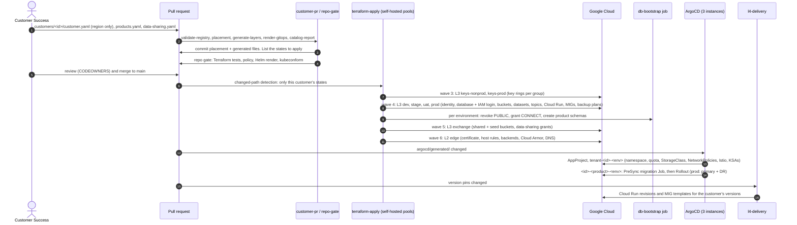

# platform-config

Infrastructure and delivery configuration for a multi-tenant, multi-product SaaS platform on Google
Cloud. It covers 15–20 products and 200+ customers, each with four environments (dev, stage, uat and prod), across three runtimes (GKE, Cloud Run and Compute Engine MIGs). Customers share pooled infrastructure and
are isolated by their own data containers, identities and namespaces.

**This is a public reference repository.** All identifiers are placeholders: organization `000000000000`,
projects `pfx-*`, domains `platform.example`, and customers `acme-corp` and `beta-industries`. Everything is validated offline,
without credentials. See [what is mocked](docs/what-is-mocked.md).

## Start here
| Read | For |
|---|---|
| [docs/architecture.md](docs/architecture.md) | The design (D1), with clarifications and the scenario traceability table |
| [docs/decisions.md](docs/decisions.md) | Key decisions: options, recommendation, rationale |
| [docs/diagrams/](docs/diagrams/) | GKE, Cloud Run and Instance Group architectures (D2), plus supporting diagrams, drawn with Google Cloud icons (SVG + PNG, legend on each); Mermaid versions in `docs/diagrams/backup/` |
| [docs/catalog.md](docs/catalog.md) | Product catalog: requirement matrix, dependency graph, version matrix |
| [docs/runbooks/](docs/runbooks/) | Onboarding, Day 2, capacity and regions, DR, break-glass |
| [docs/roadmap.md](docs/roadmap.md) | 12-week plan and product catalog timeline |
| [docs/checklist.md](docs/checklist.md) | Final checklist against D1–D5 and the acceptance criteria |

## How it works
1. **Git is the registry.**
   - `inventory/` holds regions, cells, and the cluster and SQL inventory written by L2.
   - `products/` holds the catalog.
   - `customers/` holds three files per customer.
2. **A customer PR sets only `region.primary`.** The placement job picks the cells. Generators then write:
   - the Terraform roots
   - the GitOps index
   - the catalog report
3. **Terraform manages GCP; ArgoCD manages Kubernetes.** Terraform uses only Google APIs: it never connects to a cluster (except to install ArgoCD) and never connects to a database. A bootstrap job applies the database grants.
4. **Delivery (L4):**
   - GKE: ArgoCD with Argo Rollouts
   - Cloud Run: a canary deploy step
   - MIGs: Packer images, then an Ansible-assisted rolling update

## Onboarding a customer

A customer is onboarded with one pull request that sets only `region.primary`. That works only on top of
a platform that already exists. The steps below are what must be in place first, then the sequence that
runs for every new customer.

### What must exist before the first customer (one-time, platform team)
| # | Prerequisite | Created by | Why the customer needs it |
|---|---|---|---|
| 0 | GCP organization, billing account, org admin; public DNS domain delegated to Cloud DNS | Manual (assumptions in the brief) | Everything is created under the org; customer hostnames live in the public zone |
| 1 | IaC seed project, Terraform state bucket, Terraform identities (`tf-l1`, `tf-nonprod`, `tf-prod`), workload identity pool with GitHub and Bitbucket providers | **L0**: `infrastructure/layers/L0-bootstrap/bootstrap.sh` (org admin, once) | Pipelines authenticate without keys and keep state remotely |
| 2 | GitHub repository settings: branch protection on `main`, CODEOWNERS teams, Environments `tf-<pool>` (with reviewers) and `tf-<pool>-readonly`, `deliver-*`, `promote-*`, `isolation-*`, and variables (`GCP_WIF_PROVIDER`, `TF_STATE_BUCKET`, `TF_SERVICE_ACCOUNT`, `DEPLOYER_SERVICE_ACCOUNT`, ...) | Repository admin (settings, not code) | Merges are reviewed and every apply gets the right identity and approval |
| 3 | The 12 fixed projects, Shared VPCs, org policies, VPC-SC perimeters, Artifact Registries, Binary Authorization, platform identities (promoter, seed publisher/importer, ArgoCD), management clusters, **3 ArgoCD instances with their root Applications** | **L1**: `infrastructure/layers/L1-foundation` (platform PR; GitHub-hosted for the first apply) | The customer's resources go into these projects and perimeters; ArgoCD delivers its Kubernetes objects |
| 4 | Self-hosted runner pools per environment group (devstage, uat, prod), registered to GitHub and Bitbucket | **L1** `runner-pools` + runner registration | Applies run inside the VPC-SC perimeters, which GitHub-hosted runners cannot reach |
| 5 | An **active region pair** in `inventory/regions.yaml` with cells: per group a GKE cluster (prod plus its DR cluster), Cloud SQL instances (prod plus DR replica), platform keys, the database bootstrap job, the seed work bucket; `inventory/clusters/` and `inventory/sql/` written back | **L2 region**: `infrastructure/layers/L2-region/<region>/<group>` (capacity or region PR) | Placement can only pick from cells that exist and have headroom |
| 6 | Platform add-ons on every cluster: Istio ingress/egress gateways, Argo Rollouts, cert-manager, Falco, canary analysis, label admission policy | ArgoCD root Applications (automatic once the cluster is registered) | Tenant and product releases need the gateways, CRDs and policies |
| 7 | Load balancers, Cloud Armor policies and DNS zones per group (initial apply, no customers yet) | **L2 edge**: `infrastructure/layers/L2-edge/*` | Customer host rules and certificates are added to these |
| 8 | Catalog entries for the products the customer selects, their Helm values (GKE) and, for prod pins, **promoted digests** in `products/<p>/releases.yaml` | Platform + product teams (catalog PR); `promote-image.yml` | The validator rejects unknown products, versions outside the window and unpromoted prod pins |

### Execution sequence for a new customer


| Step | What happens | Where | Typical time |
|---|---|---|---|
| 1 | Customer Success opens the PR with the three customer files | `customers/<id>/` | 5 min |
| 2 | Validation, placement (cluster + SQL instance per group, written back), generated Terraform roots and ArgoCD index committed to the PR | `customer-pr.yml`, `repo-gate.yml` | 3–5 min |
| 3 | Review and merge | CODEOWNERS | review time |
| 4 | Customer key rings, then the four environment states in parallel, then the database bootstrap job per environment | `terraform-apply.yml` waves 3–4 | ~12 min |
| 5 | Exchange resources (shared reference, seed bucket, data-sharing grants) | wave 5 | ~2 min |
| 6 | Edge: certificate, host rules, backends, DNS | wave 6 | ~5 min (+ certificate issuance) |
| 7 | Kubernetes: AppProject, tenant namespaces, product releases on the primary and DR clusters | ArgoCD (automatic) | 5–10 min |
| 8 | Cloud Run and MIG versions deployed | `l4-delivery.yml` | 5–10 min, in parallel with 7 |
| 9 | Smoke test and isolation sample | `isolation-tests.yml` | ~5 min |

If placement finds no free cell, it exits with a capacity request. A capacity PR adds a cell and L2 builds it
([runbooks/capacity.md](docs/runbooks/capacity.md)); then placement is re-run. The full procedure, review checklist
and rollback are in [docs/runbooks/onboarding.md](docs/runbooks/onboarding.md).

## Repository layout
```
docs/                      design (D1), decisions, diagrams (D2), catalog, runbooks, roadmap, checklist
inventory/                 platform.yaml, regions.yaml, clusters/ and sql/ (written by L2)
products/                  _schema/ + one directory per product: product.yaml, releases.yaml, helm/ values
customers/                 _schema/ + one directory per customer: customer.yaml, products.yaml, data-sharing.yaml
infrastructure/            Terraform (D3): modules/ and layers/ L0-L3 (L2/L3 roots generated)
helm/                      tenant and product-base charts (D4)
argocd/                    app-of-apps chart, add-on charts, generated GitOps index
db-bootstrap/              database bootstrap job (revoke PUBLIC, grant CONNECT, product schemas)
data-flows/                seed down (sanitize, verify, role mapping), BigQuery anonymization, promote up
packer/  ansible/          Instance Group path (golden image, configuration, migrations)
ci-templates/              build-scan-sign (GitHub composite action, Bitbucket template), delivery scripts
policy/                    static policy checks for Terraform and rendered manifests
scripts/                   placement, generators, gates, changed-path detection
tests/isolation/           tenant isolation tests (offline case generation, live probes)
examples/rendered/         ApplicationSet output and rendered manifests for the example customers
.github/workflows/         repo gate, customer PR, apply, drift, delivery, promotion, isolation tests
```

## Quickstart (offline, no credentials)
Requirements: Python 3.12+, Terraform ≥ 1.7 (tested with 1.17), Helm 3, kubeconform, tflint and Packer.

```bash
pip install -r requirements-dev.txt

python scripts/validate-registry.py              # catalog + customer rules
python scripts/placement/placement.py --repo . --all          # placement (dry run)
python scripts/generate-layers.py --check        # Terraform roots in sync
python scripts/render-gitops.py --check          # GitOps index in sync
python scripts/terraform-check.py                # fmt, validate, terraform test (mock providers)
python policy/check_terraform.py                 # labels, IAM allowlist, no public IPs
python scripts/gitops-check.py                   # helm lint/template, ApplicationSets, kubeconform, policy
python -m pytest -q scripts db-bootstrap data-flows policy tests/isolation
```
CI runs the same checks in [`repo-gate.yml`](.github/workflows/repo-gate.yml), plus tflint, packer validate, ansible-lint, actionlint and gitleaks.

## Apply order (L0 → L4)
| Layer | What | How | Runs on |
|---|---|---|---|
| L0 | Seed project, state bucket, Terraform identities, WIF for GitHub and Bitbucket | `infrastructure/layers/L0-bootstrap/bootstrap.sh` (once, by an org admin) | Laptop with org admin |
| L1 | 12 projects, Shared VPCs, org policies, VPC-SC, runner pools, management clusters, the 3 ArgoCD instances | Terraform, platform PR | GitHub-hosted for the first apply, then the prod pool |
| L2 | Per region and group: cells (clusters, prod DR clusters), Cloud SQL + DR replicas, platform keys, bootstrap job; per group: edge (LB, Cloud Armor, certificates, DNS) | Terraform, capacity or region PR | Group's self-hosted pool |
| L3 | Per customer: keys, the 4 environments (identity, database + login, buckets, datasets, topics, Cloud Run, MIGs, backups), exchange | Terraform, customer PR, then the bootstrap job | Group's self-hosted pool |
| L4 | Tenant namespaces, workloads, migrations, version rollouts | ArgoCD; Cloud Run and MIG delivery workflow | ArgoCD; self-hosted pools |

After a merge, [`terraform-apply.yml`](.github/workflows/terraform-apply.yml) applies only the states the change touches, in waves. The backend is a GCS bucket from [`infrastructure/backend.hcl.example`](infrastructure/backend.hcl.example).

## Depth of implementation
| Component | Depth |
|---|---|
| L0 script, L1, L2 (clusters, SQL + replicas, LBs, exchange), L3 composition and its data/identity modules, Cloud Run and MIG modules | Implemented, `terraform test` with mock providers |
| Placement job, database bootstrap job, registry validator, generators, changed-path detection | Implemented, unit-tested |
| Tenant chart, product base chart, ArgoCD app-of-apps and ApplicationSets, two example customers | Implemented, rendered and schema-validated end to end |
| CI: repo gate, customer PR, apply waves, drift, delivery, image promotion, Bitbucket template | Implemented workflows (the apply and delivery paths need the real environment) |
| Seed-down function and sanitization SQL, promote-up pipeline, isolation tests | Skeleton + documentation; planning logic unit-tested |
| Packer/Ansible path | One minimal working example (`legacy-billing`) |
| DR runbooks, Falco and SCC configuration | Documentation + configuration |

## Public-repository safety
- **Pull requests (including forks)** run only offline checks on GitHub-hosted runners, with a read-only token: no secrets and no cloud credentials.
- **Apply, delivery, promotion, drift and isolation workflows** run only on `main` or by manual dispatch. They use self-hosted pools, and GitHub Environments supply the identities and the required reviewers. Authentication is through Workload Identity Federation, so no keys are stored anywhere.
- **Secrets:** gitleaks scans the full history on every PR. `.gitignore` excludes state, tfvars and `backend.hcl`.

## Contributing
See [CONTRIBUTING.md](CONTRIBUTING.md). License: [MIT](LICENSE).
