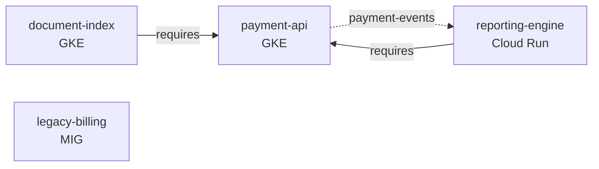

<!-- GENERATED by scripts/catalog-report.py from products/ and customers/. Do not edit. -->
# Product catalog

The catalog is platform-owned (`products/<product>/product.yaml`, schema in [`products/_schema`](../products/_schema/product.schema.json)). Customers select products in `customers/<customer>/products.yaml`. `scripts/validate-registry.py` enforces the composition rules (architecture §6).

## Requirement matrix

| Product | Short code | Owner | Runtime | Cloud SQL schema | GCS bucket | BigQuery dataset | Publishes | Subscribes | Persistent volume | Egress allowlist | PII / PCI | Config export | Supported releases |
|---|---|---|---|---|---|---|---|---|---|---|---|---|---|
| `document-index` | `docindex` | team-search | GKE | ✓ | ✓ | – | – | – | 50Gi (ARB-2026-014) | – | ✓ / – | ✓ | 1.0, 1.1, 1.2 |
| `legacy-billing` | `billing` | team-billing | MIG | ✓ | ✓ | – | – | – | – | – | ✓ / ✓ | – | 3.2, 3.3, 3.4 |
| `payment-api` | `payment` | team-payments | GKE | ✓ | ✓ | – | `events` | – | – | `api.stripe.example:443` | ✓ / ✓ | ✓ | 2.4, 2.5, 2.6 |
| `reporting-engine` | `reporting` | team-insights | Cloud Run | ✓ | ✓ | ✓ | – | `payment-events` | – | – | ✓ / – | ✓ | 1.7, 1.8, 1.9 |

What a customer gets per enabled product and environment: the product's schema in the customer's database, plus a bucket, a dataset and topics only where the matrix shows them (prod also gets a DR dataset). GKE products get a Helm release per environment (and on the DR cluster in prod); Cloud Run and MIG products get a service or MIG per environment (and in the DR region in prod).

## Sizing per environment

| Product | dev | stage | uat | prod |
|---|---|---|---|---|
| `document-index` | 2–2 × 500m / 1Gi | 2–2 × 500m / 1Gi | 2–3 × 1 / 2Gi | 3–6 × 2 / 4Gi |
| `legacy-billing` | 1–2 × `e2-standard-2` | 1–2 × `e2-standard-2` | 3–3 × `e2-standard-4` | 3–9 × `n2-standard-4` |
| `payment-api` | 1–2 × 250m / 512Mi | 1–3 × 250m / 512Mi | 2–4 × 500m / 1Gi | 3–10 × 1 / 2Gi |
| `reporting-engine` | 0–2 inst × 1 / 512Mi | 0–2 inst × 1 / 512Mi | 0–4 inst × 1 / 1Gi | 1–20 inst × 2 / 2Gi |

## Dependency graph

Solid arrows are required dependencies (must be enabled in the same environment). Dashed arrows are Pub/Sub flows from publisher to subscriber.

## Version matrix

Pinned versions per customer, product and environment (`customers/*/products.yaml`). CI publishes the same data as `version-matrix.json`.

| Customer | Product | dev | stage | uat | prod |
|---|---|---|---|---|---|
| `acme-corp` | `payment-api` | `2.6.0-beta.1` | `2.5.1` | `2.5.1` | `2.5.0` |
| `acme-corp` | `reporting-engine` | `1.9.0` | `1.8.3` | `1.8.3` | `1.8.2` |
| `beta-industries` | `legacy-billing` | `3.4.1` | `3.4.1` | `3.3.2` | `3.3.2` |
| `beta-industries` | `payment-api` | `2.5.1` | `2.5.1` | `2.5.1` | `2.5.0-beta-industries.1` |

## Adoption

| Product | Customers |
|---|---|
| `document-index` | – |
| `legacy-billing` | `beta-industries` |
| `payment-api` | `acme-corp`, `beta-industries` |
| `reporting-engine` | `acme-corp` |
