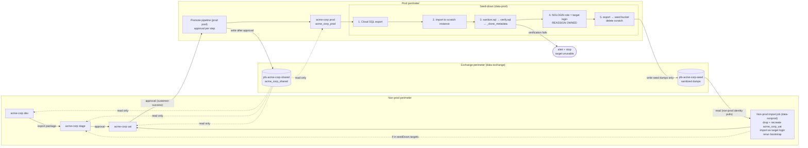

# Data-sharing flows (within one customer) (Mermaid, backup)

Backup of the Mermaid version. The current diagram is the Google Cloud icon version on [../data-sharing.md](../data-sharing.md).

Three one-way, audited flows. No live cross-environment connections, and no path between customers. See [architecture §9](../../architecture.md#9-data-sharing-within-a-customer).

| Flow | Policy (`data-sharing.yaml`) | Guard |
|---|---|---|
| Shared reference | `sharedReference: true` | Written only by the promote pipeline |
| Promote up | `promoteUp: { enabled, approvals }` | Approval per step, version-compatibility window, product export/import support |
| Seed down | `seedDown: { targets, mode: sanitized, schedule }` | Mandatory sanitization + verification, version-compatibility window, same region, no prod identity writes to non-prod |

BigQuery seed down uses a scheduled anonymizing query into the exchange dataset. GCS uses Storage Transfer Service with sensitive prefixes excluded. PVCs and Pub/Sub messages are never shared.
