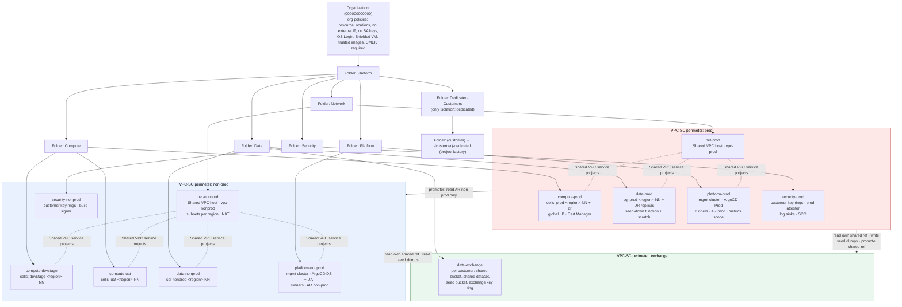

# Resource hierarchy and VPC-SC perimeters (Mermaid, backup)

Backup of the Mermaid version. The current diagram is the Google Cloud icon version on [../hierarchy.md](../hierarchy.md).

Regions and cells are resources inside the fixed projects, not projects. See [architecture §2](../../architecture.md#2-resource-hierarchy-and-project-model).

