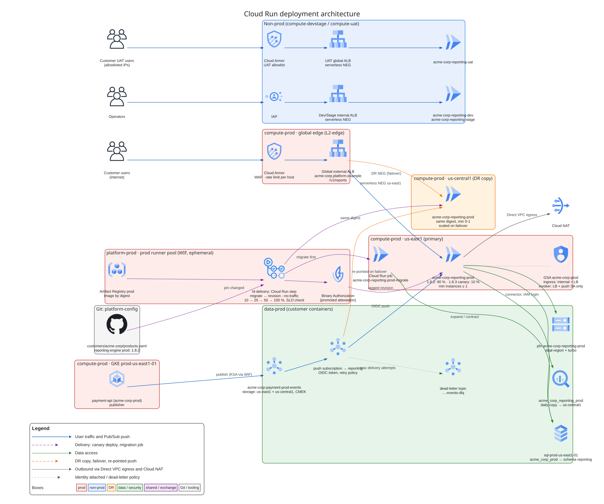

# Cloud Run deployment architecture (D2)

Example: `acme-corp` runs `reporting-engine` (Cloud Run), which subscribes to events published by `payment-api` (GKE). The customer's region is `us-east1` and its DR pair is `us-central1`.

SVG (zoomable): [cloud-run-gcp.svg](cloud-run-gcp.svg) · PNG: [cloud-run-gcp.png](cloud-run-gcp.png) · source: [src/cloud_run.py](src/cloud_run.py) · Mermaid version (backup): [backup/cloud-run.md](backup/cloud-run.md)

## What the diagram shows

| Aspect | Where |
|---|---|
| Topology | One service per customer × product × env, in the env group's compute project and the customer's region. Prod has a second copy in the pair region. |
| Tenant isolation | Separate service per customer, running as the customer env GSA, which can only reach that customer's database (`CONNECT`), bucket, dataset and topics. Invoker IAM allows only the LB and the customer's push SA. A per-tenant network tag drives the firewall. |
| Ingress | Prod: Cloud Armor → global ALB → serverless NEG; ingress is restricted to `internal-and-cloud-load-balancing`. Dev/Stage: internal ALB with IAP. UAT: allowlisted global ALB. |
| Egress | Direct VPC egress for all traffic → VPC firewall → Cloud NAT. |
| Events | GKE `payment-api` publishes. The Cloud Run service subscribes through an OIDC-authenticated push (or Eventarc), with a dead-letter topic and retry. Consumers are idempotent. |
| Deploy path | Version pin in Git → prod runner pool deploy step: migration job, then a no-traffic revision, then a staged traffic split with automatic rollback. Terraform (L3) owns the service shape and ignores the revision. |
| DR copy | Same digest deployed in `us-central1` behind a second serverless NEG on the same backend service. Push subscriptions are re-pointed on failover. |
