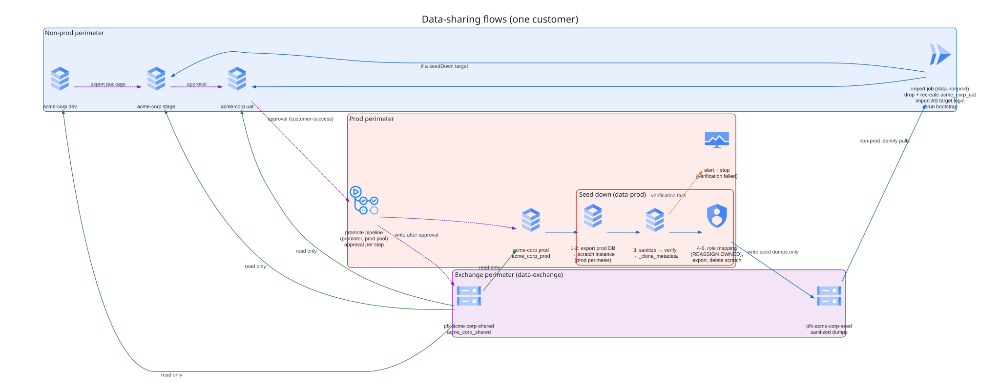

# Data-sharing flows (within one customer)

Three one-way, audited flows. No live cross-environment connections, and no path between customers. See [architecture §9](../architecture.md#9-data-sharing-within-a-customer).

SVG (zoomable): [data-sharing-gcp.svg](data-sharing-gcp.svg) · PNG: [data-sharing-gcp.png](data-sharing-gcp.png) · source: [src/data_sharing.py](src/data_sharing.py) · Mermaid version (backup): [backup/data-sharing.md](backup/data-sharing.md)

| Flow | Policy (`data-sharing.yaml`) | Guard |
|---|---|---|
| Shared reference | `sharedReference: true` | Written only by the promote pipeline |
| Promote up | `promoteUp: { enabled, approvals }` | Approval per step, version-compatibility window, product export/import support |
| Seed down | `seedDown: { targets, mode: sanitized, schedule }` | Mandatory sanitization + verification, version-compatibility window, same region, no prod identity writes to non-prod |

BigQuery seed down uses a scheduled anonymizing query into the exchange dataset. GCS uses Storage Transfer Service with sensitive prefixes excluded. PVCs and Pub/Sub messages are never shared.
