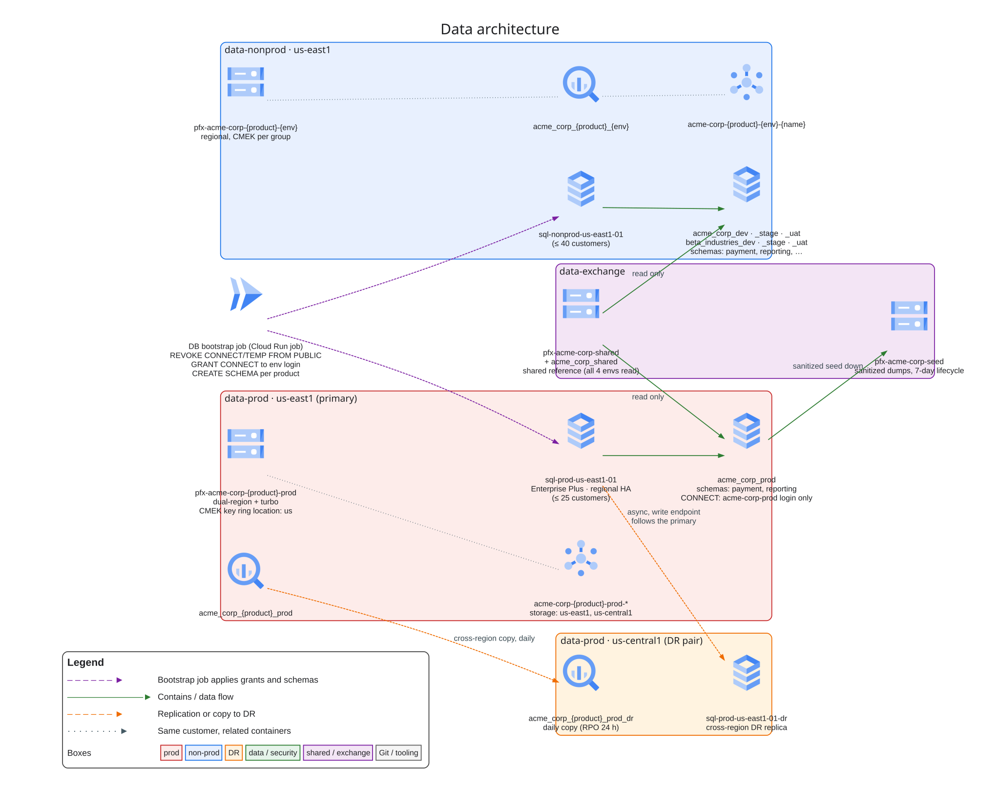

# Data architecture

Shared instances, per-customer containers. See [architecture §8](../architecture.md#8-data-architecture).

SVG (zoomable): [data-gcp.svg](data-gcp.svg) · PNG: [data-gcp.png](data-gcp.png) · source: [src/data.py](src/data.py) · Mermaid version (backup): [backup/data.md](backup/data.md)

| Store | Unit per customer | Isolation | Prod DR |
|---|---|---|---|
| Cloud SQL | database per env, schema per product | `CONNECT` per env login | DR replica, RPO ~5 min |
| GCS | bucket per product per env | bucket IAM + CMEK | dual-region turbo, RPO ≤ 15 min |
| BigQuery | dataset per product per env | dataset IAM + CMEK | daily copy, RPO 24 h |
| Pub/Sub | topics per product per env | topic/sub IAM + CMEK | storage in region + pair |
| PVC (exception) | PVC in customer namespace | namespace + per-customer StorageClass/CMEK | Backup for GKE in pair |
