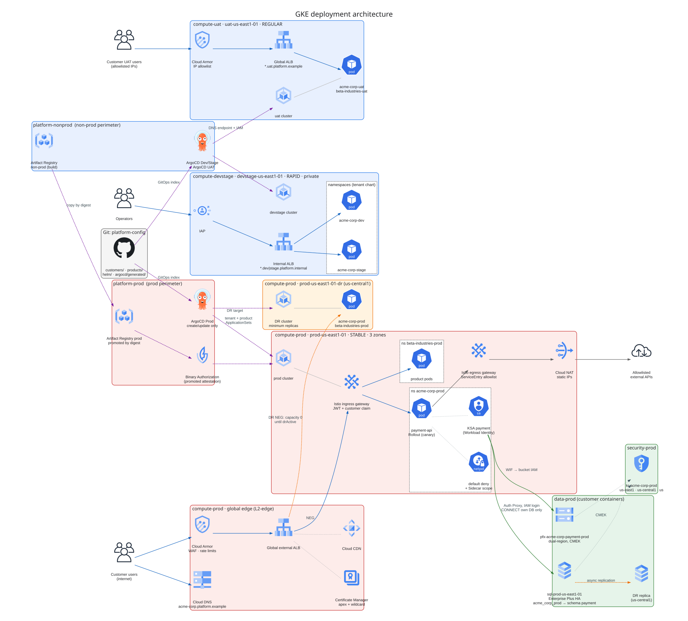

# GKE deployment architecture (D2)

It shows one region (`us-east1`) with its DR pair (`us-central1`) and the two example customers. Other regions repeat the same pattern.

SVG (zoomable): [gke-gcp.svg](gke-gcp.svg) · PNG: [gke-gcp.png](gke-gcp.png) · source: [src/gke.py](src/gke.py) · Mermaid version (backup): [backup/gke.md](backup/gke.md)

## What the diagram shows

| Aspect | Where |
|---|---|
| Topology | Three environment groups, each with its own cluster and exposure. The management clusters host the ArgoCD instances. |
| Tenant isolation | One namespace per customer per env from the tenant chart: default-deny NetworkPolicy, Istio Sidecar scoping and AuthorizationPolicy, quotas, a per-customer StorageClass and AppProject. Data isolation comes from per-customer containers (database, bucket) and identities. |
| Ingress | Dev/Stage: IAP → internal ALB. UAT: Cloud Armor allowlist → global ALB. Prod: Cloud Armor → global ALB + CDN → Istio ingress gateway (JWT checked). |
| Egress | Istio egress gateway with a ServiceEntry allowlist, NetworkPolicy + firewall default deny, Cloud NAT static IPs. |
| Identity | KSA principal via WIF for GCS/BQ/PubSub/KMS/Secret Manager. Pods impersonate the customer env GSA for Cloud SQL IAM login. |
| Deploy path | Git → ArgoCD (per group) → private cluster endpoints. Images are built into the non-prod AR and promoted by digest into the prod AR. Binary Authorization requires the prod attestation. |
| DR copy | Dedicated `prod-us-east1-01-dr` in `us-central1` receives every prod Application at minimum replicas. The Cloud SQL DR replica sits in the same pair region, and the LB fails over to the DR NEG. |
