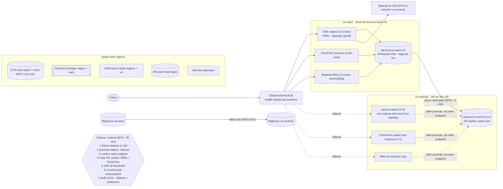

# HA and DR (per prod cell)

> **Google Cloud icon version:** [ha-dr-gcp.svg](ha-dr-gcp.svg) (zoomable) · [ha-dr-gcp.png](ha-dr-gcp.png) · source [src/ha_dr.py](src/ha_dr.py). The Mermaid diagram below has the same content.

Warm standby in the DR pair by default. Failover is per cell. See [architecture §12](../architecture.md#12-ha-and-dr).

| Profile | RTO | RPO |
|---|---|---|
| Zone failure | ~1-5 min | 0 |
| Region failure, warm standby (default) | ~30 min | ~5 min |
| Region failure, hot standby (opt-in) | ~5 min | ~1 min |
| Non-prod | 4 h | 24 h |
