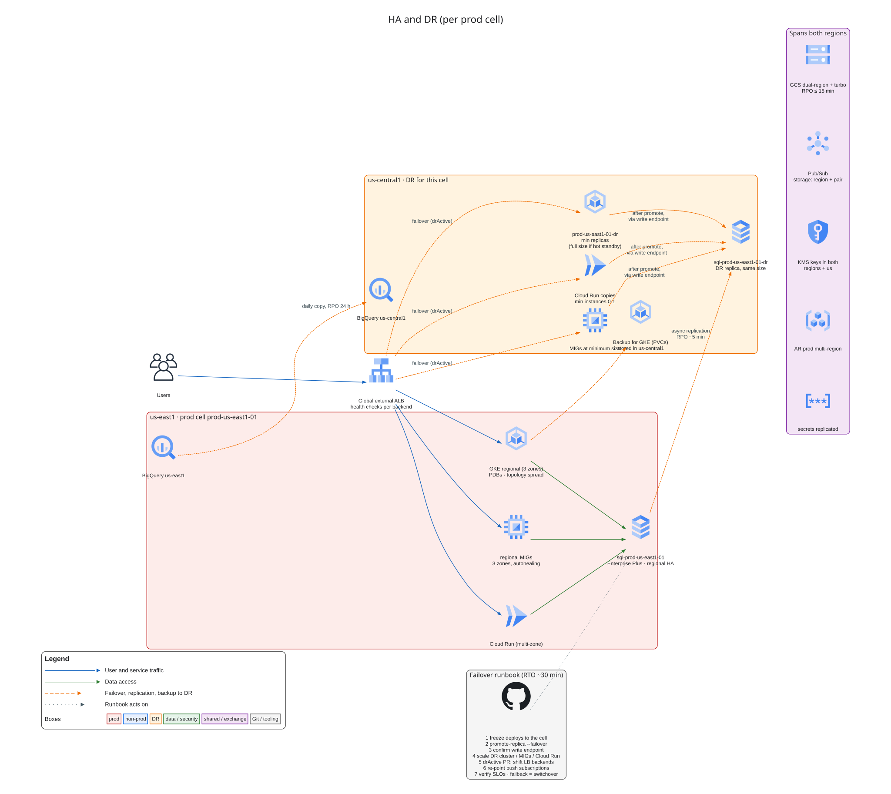

# HA and DR (per prod cell)

Warm standby in the DR pair by default. Failover is per cell. See [architecture §12](../architecture.md#12-ha-and-dr).

SVG (zoomable): [ha-dr-gcp.svg](ha-dr-gcp.svg) · PNG: [ha-dr-gcp.png](ha-dr-gcp.png) · source: [src/ha_dr.py](src/ha_dr.py) · Mermaid version (backup): [backup/ha-dr.md](backup/ha-dr.md)

| Profile | RTO | RPO |
|---|---|---|
| Zone failure | ~1-5 min | 0 |
| Region failure, warm standby (default) | ~30 min | ~5 min |
| Region failure, hot standby (opt-in) | ~5 min | ~1 min |
| Non-prod | 4 h | 24 h |
