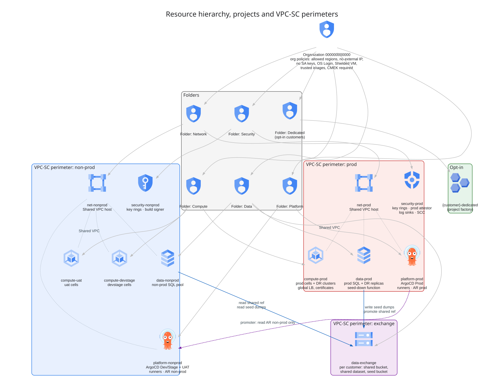

# Resource hierarchy and VPC-SC perimeters

Regions and cells are resources inside the fixed projects, not projects. See [architecture §2](../architecture.md#2-resource-hierarchy-and-project-model).

SVG (zoomable): [hierarchy-gcp.svg](hierarchy-gcp.svg) · PNG: [hierarchy-gcp.png](hierarchy-gcp.png) · source: [src/hierarchy.py](src/hierarchy.py) · Mermaid version (backup): [backup/hierarchy.md](backup/hierarchy.md)
