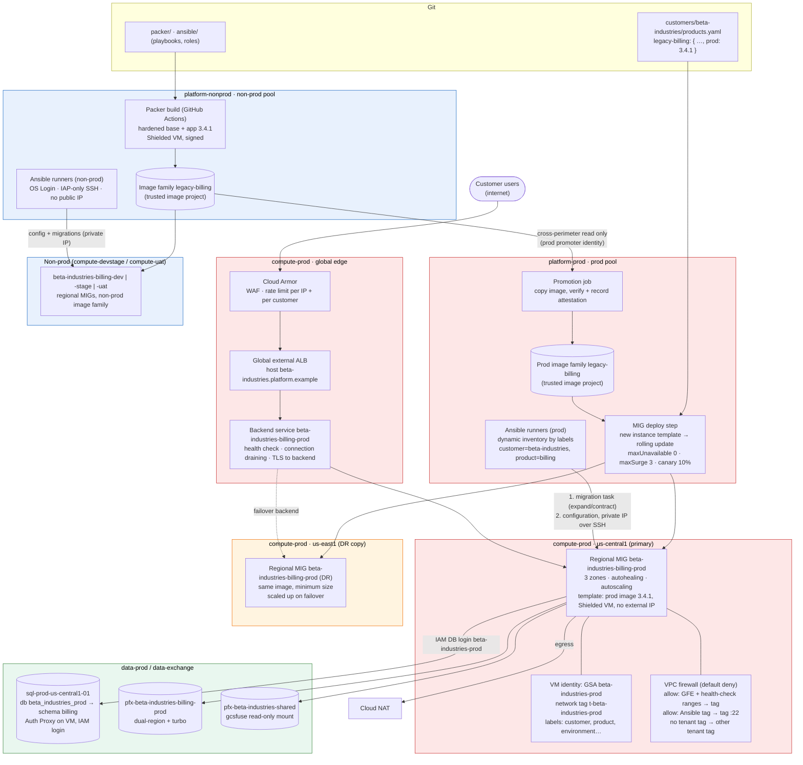

# Instance Group (MIG) deployment architecture (D2)

Exported SVG: [instance-group.svg](instance-group.svg). Example: `beta-industries` runs `legacy-billing` (VM-based) in `us-central1`, with its DR pair in `us-east1`.

## What the diagram shows

| Aspect | Where |
|---|---|
| Topology | Stateless regional MIG per customer × product × env (3 zones, autohealing), in the env group's compute project. No data disks: code is in the Packer image, config comes from Ansible, data lives in Cloud SQL/GCS. |
| Tenant isolation | Separate MIG and instance template running as the customer env GSA. Per-tenant network tag with default-deny firewall: only LB/health-check ranges and the Ansible runners can reach a tenant's VMs, and no tenant tag can reach another. Data access is limited to that customer's containers. |
| Ingress | Cloud Armor → global ALB → backend service → regional MIG, with TLS to the backend and connection draining. |
| Egress | Firewall → Cloud NAT. |
| Identity | VM service account = customer env GSA; IAM DB login through the Cloud SQL Auth Proxy; OS Login for operators through IAP only. |
| Deploy path | Packer (non-prod pool) → non-prod image family → promotion (prod pool) → prod image family → new instance template → rolling update (`maxUnavailable=0`). Ansible runs migrations first, then configuration. Blue-green uses a second MIG on the same backend service. |
| DR copy | Same image in a MIG in the pair region at minimum size, attached as a failover backend and scaled up on failover. |
