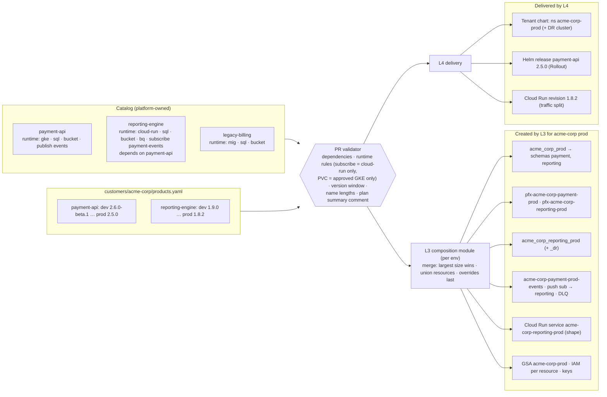

# Multi-product composition

How the catalog and a customer's selection become infrastructure and workloads. See [architecture §6](../architecture.md#6-multi-product-and-multi-customer-model).

**Day 2**
- **Add:** a PR to `products.yaml`. L3 adds only the new product's resources, then bootstrap creates the schema and L4 deploys it.
- **Remove:** phased decommission with a retention period and two approvals. Other products are untouched.
- **Upgrade:** version pin PRs in rollout waves.
