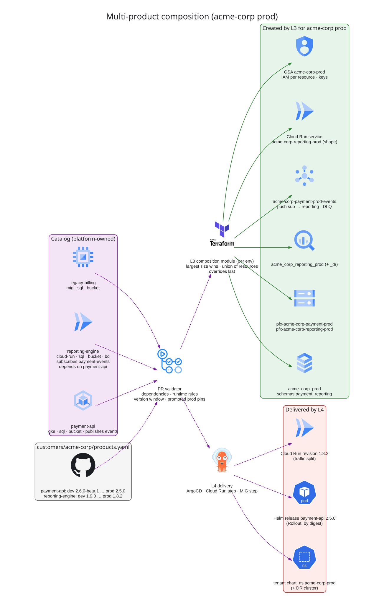

# Multi-product composition

How the catalog and a customer's selection become infrastructure and workloads. See [architecture §6](../architecture.md#6-multi-product-and-multi-customer-model).

SVG (zoomable): [multi-product-gcp.svg](multi-product-gcp.svg) · PNG: [multi-product-gcp.png](multi-product-gcp.png) · source: [src/multi_product.py](src/multi_product.py) · Mermaid version (backup): [backup/multi-product.md](backup/multi-product.md)

**Day 2**
- **Add:** a PR to `products.yaml`. L3 adds only the new product's resources, then bootstrap creates the schema and L4 deploys it.
- **Remove:** phased decommission with a retention period and two approvals. Other products are untouched.
- **Upgrade:** version pin PRs in rollout waves.
