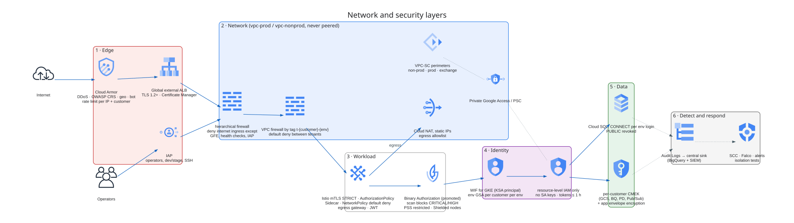

# Network and security

Defense in depth from the edge to the data. See [architecture §10-11](../architecture.md#10-identity-and-encryption).

SVG (zoomable): [network-security-gcp.svg](network-security-gcp.svg) · PNG: [network-security-gcp.png](network-security-gcp.png) · source: [src/network_security.py](src/network_security.py) · Mermaid version (backup): [backup/network-security.md](backup/network-security.md)
