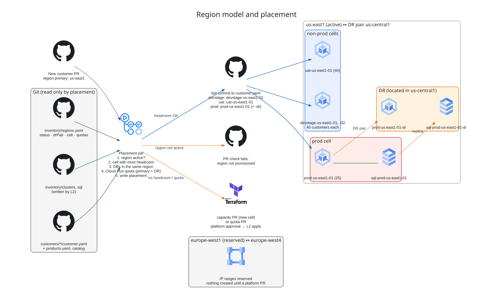

# Region model and placement

See [architecture §3](../architecture.md#3-regions-cells-and-placement).

SVG (zoomable): [regions-gcp.svg](regions-gcp.svg) · PNG: [regions-gcp.png](regions-gcp.png) · source: [src/regions.py](src/regions.py) · Mermaid version (backup): [backup/regions.md](backup/regions.md)

IP plan per region per side: see the table in architecture §3. Pods come from `100.64.0.0/10`, so the region `/16` holds only nodes, services, Cloud Run egress, MIGs, proxies, PSC and PSA.
