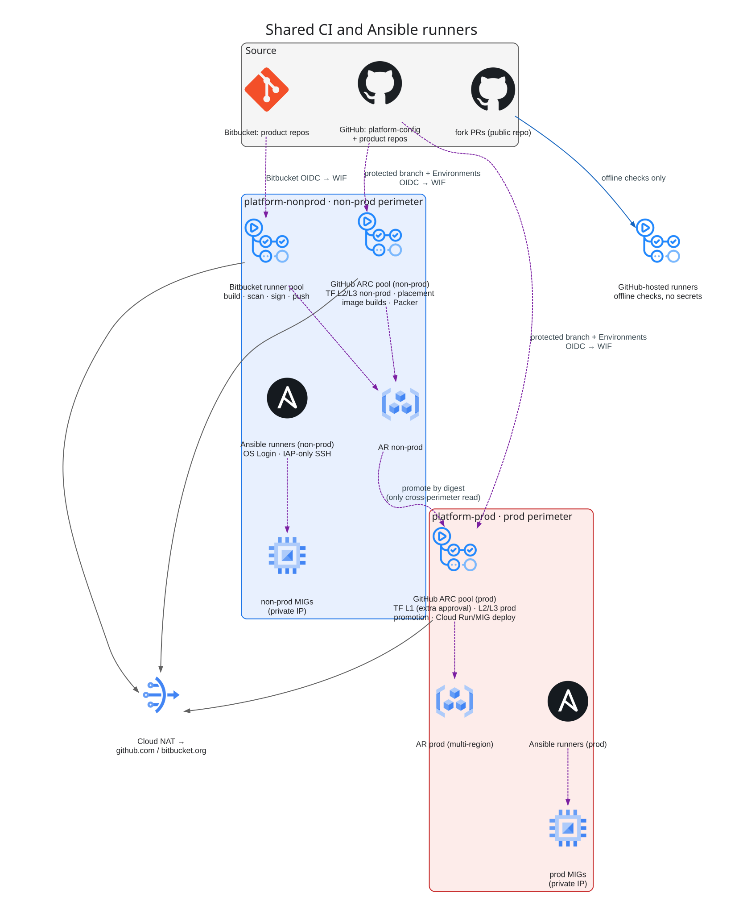

# Shared CI and Ansible runner topology

See [architecture §15](../architecture.md#15-shared-ci-and-ansible-runners).

SVG (zoomable): [runners-gcp.svg](runners-gcp.svg) · PNG: [runners-gcp.png](runners-gcp.png) · source: [src/runners.py](src/runners.py) · Mermaid version (backup): [backup/runners.md](backup/runners.md)

| Property | Value |
|---|---|
| Lifetime | Ephemeral, one job per runner |
| Network | No public IP, inside the VPC-SC perimeter, egress through Cloud NAT |
| Auth | WIF (GitHub OIDC, Bitbucket OIDC), no keys |
| Scope | Non-prod pool identity: non-prod projects only. Prod pool identity: prod projects plus the non-prod AR read |
